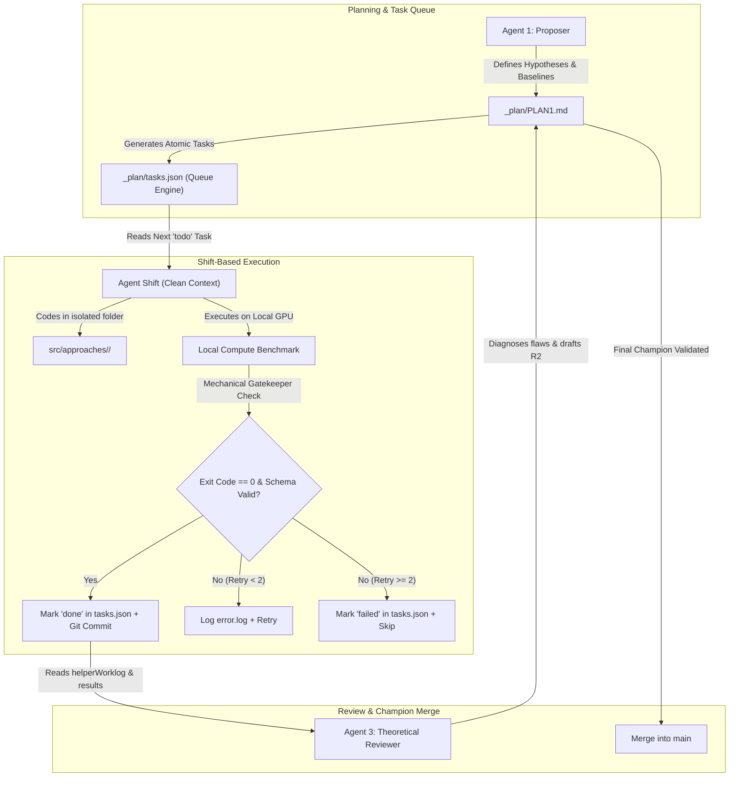

# 2-Round Multi-Agent Iterative Workflow (`rules_plan_workflow.md`)

This protocol orchestrates a structured, 2-round research and engineering cycle across specialized AI agents. It enforces:
1. **First-Principles & Mathematics First**: Zero tolerance for naive machine learning buzzwords without mathematical alignment with system physics and invariants.
2. **Shift-Based Execution via `tasks.json`**: State persistence on disk to eliminate context rot across agent sessions.
3. **Mechanistic Verification Gatekeeper**: Zero trust in self-assessed completion; status `"done"` requires exit code 0 and valid artifact schemas.
4. **Immutability of Core Foundation**: `src/core/` is locked during experiments to prevent regression and benchmark drift.



---

## 1. The "First-Principles & Mathematics First" Doctrine

### A. The Anti-Naive-ML Rule
- **Prohibited Behavior**: Agents must **NEVER** naively propose generic off-the-shelf architectures (e.g., standard Vision Transformers, Diffusion, generic GANs, off-the-shelf GNNs, or brute-force MLPs) simply because they are popular.
- **Mandatory First-Principles Qualification**: Before any approach is admitted into `PLAN.md`, the Proposer Agent must explicitly prove:
  1. **Discretization & Resolution Alignment**: How does the method respect the problem's sampling resolution, discretization grid, or temporal/spatial bin limits?
  2. **Algebraic & Structural Integrity**: Does the mathematical formulation preserve essential domain invariants? (e.g., conservation laws, positive semi-definiteness, permutation invariance, boundary conditions, or rank properties).
  3. **Asymptotic & Regime Consistency**: Does the model suffer from an artificial saturation/floor in extreme regimes (e.g., zero-noise limit, high-SNR, large scale $N$, or extreme sparsity)? Architectures must incorporate inductive biases (such as residuals on classical estimators with zero-initialization) to guarantee that they gracefully converge to known analytical solutions at the limits.

### B. Benchmark Baseline Hierarchy
Every candidate must be compared against two mandatory baselines:
1. **Classical / Analytical Baseline**: e.g., Classical numerical solver, convex relaxation, greedy heuristic, or linear estimator.
2. **Theoretical Bound / Optimal Ceiling**: e.g., Bayes optimal error, Cramér-Rao Bound (CRLB), dual relaxation, or oracle benchmark.
*Rule: If a complex deep learning model cannot outperform the classical baseline across all operating regimes, it is structurally misspecified and must be redesigned.*

---

## 2. Shift-Based Execution & State Persistence (`_plan/tasks.json`)

To prevent **Context Rot** (loss of reasoning quality as token context fills with debug logs):
1. **The Single Source of Truth for Execution**: `_plan/tasks.json` holds the machine-readable state of all experiments.
2. **One Shift = One Atomic Task**:
   - Each agent session/shift must only execute **one atomic task** from `tasks.json`.
   - The agent reads `_plan/tasks.json`, selects the first task where `"status": "todo"`, sets it to `"in_progress"`, and saves the file back to disk.
   - When the task passes verification, it sets `"status": "done"`, updates the commit hash, and ends the turn.
3. **Session Handoff**: If continuing autonomously (e.g., via `/goal`), subsequent execution cycles start with a clean context, immediately reading `_plan/tasks.json` to resume where the last shift ended.

---

## 3. The Mechanistic Verification Gatekeeper (Zero Trust in Self-Claims)

An agent is **strictly forbidden** from marking a task as `"done"` simply because the code ran or finished generating text. A task is verified **only** when all three mechanized checks pass:

```
[Execution Completed]
         │
         ├── Check 1: Terminal Exit Code == 0? ────► [No] ─► Status: "failed" (Log error.log)
         │                   │ [Yes]
         ├── Check 2: Output JSON Exists & Non-Empty? ─► [No] ─► Status: "failed"
         │                   │ [Yes]
         └── Check 3: Schema & Sanity Valid? ──────► [No (Contains NaN/Inf)] ─► Status: "failed"
                             │ [Yes]
                 ✅ Status: "done" (Persist state & Git commit)
```

1. **Check 1: Process Exit Code**: The command must return code `0` (`$? == 0` or `$LASTEXITCODE -eq 0`).
2. **Check 2: Expected Output Artifact**: The file specified in `verification.expected_artifacts` (e.g., `results/result.json`) must exist on disk and have file size $> 0$ bytes.
3. **Check 3: Numerical Sanity**: The JSON artifact must contain all `required_keys` and contain **zero** disallowed values (`NaN`, `Infinity`, `null`, negative loss if bounded).

If any check fails:
- Increment `retry_count`.
- If `retry_count < max_retries`: log the stack trace to `error.log`, apply a targeted fix, and re-run.
- If `retry_count >= max_retries`: mark `"status": "failed"`, record `error_message`, and proceed to the next task. **Never loop infinitely.**

### D. Circuit Breakers (Anti-Burnout & Loop Prevention)
- **Max Retries**: Each task is allowed a maximum of **2 retries**. If a task fails twice, mark it as `"failed"`, record the traceback in `error.log`, and advance to the next task. Never retry in an infinite loop.
- **Emergency Halt**: If **3 consecutive tasks** fail, halt autonomous execution immediately and alert the user.
- **Timeout Guard**: Terminate and log any individual task that exceeds 30 minutes runtime.

### E. Deterministic Seed Locking (Scientific Reproducibility)
- **Fixed Seeds**: Random seeds must be strictly fixed to `[0, 1, 2]`. Ctx-random or ad-hoc seeds are forbidden.
- **Reporting Format**: All metrics reported in `_note/WORKLOG.md` and `results/result.json` must be computed as **`Mean ± Std`** across the 3 fixed seeds.

---

## 4. Immutability of Core Foundation (`src/core/`)

To prevent regression bugs and benchmark drift:
- **`src/core/` is Read-Only during Approach Experiments**: Files under `src/core/` (dataloaders, metric formulas, baseline definitions) are frozen. Agents must NEVER modify `src/core/` while developing an individual approach.
- **Isolated Sandboxing in `src/approaches/`**: All approach-specific code, models, and custom loss functions must live exclusively within `src/approaches/<approach_name>/`.
- **Core Update Protocol**: If a bug is discovered in `src/core/`, it must be resolved in a dedicated branch, verified against existing baseline unit tests (`test_baselines.py`), and merged before resuming experiments.

---

## 5. Remote Branching & Ablation Tracking Policy

### A. The "Push All Valid Experiments" Rule
- **Every valid experiment must be pushed to a dedicated remote branch**:
  - Round 1 branches: `exp/r1-<approach-name>` (e.g., `exp/r1-a1-residual-solver`)
  - Round 2 branches: `exp/r2-<refined-name>` (e.g., `exp/r2-b1-hybrid-mixer`)
- **Negative Results are High-Value Scientific Assets**:
  - Do **NOT** delete or hide branches that underperform.
  - As long as the code executed successfully without crashing, commit and push the branch.
  - Mark its status in `PLAN.md` and `tasks.json` as `Degraded (Ablation Asset)`.
  - These negative runs serve as direct evidence for the deliverable's **Ablation Studies**.

### B. Pre-Push Guardrail (`pre_push_check.py`)
Before running `git push-collab` or `git push`:
- Run `python pre_push_check.py` to confirm no heavy files (`*.pt`, `*.mat` > 10MB) are tracked.
- Model checkpoint weights and raw datasets are strictly forbidden from Git tracking (`.gitignore`).

### C. Clean `main` Branch Invariance
- The `main` branch must remain **100% stable, clean, and publication/production-ready**.
- Never commit experimental work directly to `main`.
- Only the single validated **Champion Approach** from Round 2 is merged into `main`.

---

## 6. Detailed Agent Roles & Step-by-Step Directives

### Role 1: Proposer Agent (Lead Scientist / Architect)
1. Inspect governing equations, dimensional scales, conservation laws, and operating regimes.
2. Initialize Section 0 & 1 of `_plan/PLAN1.md` with rigorous mathematical specifications.
3. Populate `_plan/tasks.json` with the corresponding atomic tasks, execution commands, and verification criteria.

### Role 2: Implementer / Runner Agent (Local Compute + Remote Push)
1. Read `_plan/tasks.json` and pick the first pending task. Mark as `"in_progress"`.
2. Check out the assigned branch: `git checkout -b exp/r1-<name>`.
3. Implement the architecture in `src/approaches/<name>/` strictly adhering to the mathematical spec.
4. Execute the benchmark on **local compute** (utilizing local GPU/CPU hardware and local data paths).
5. Apply the **Mechanistic Gatekeeper**: verify Exit Code 0 and parse `result.json`.
6. Record outputs:
   - **`_note/helperWorklog/details_yymmdd-hhmm.md`**: Full raw logs, per-seed metrics, loss curves, and hyperparameters.
   - **`_note/WORKLOG.md`**: Top-line summary table, key plot, and link to the detail file (placed at top of file, dated by day only).
7. Commit and push:
   ```bash
   git add src/approaches/<name>/ _note/ results/*.json results/*.pdf
   git commit -m "exp(r1-<name>): complete benchmark run with <metric-summary>"
   git push -u origin exp/r1-<name>
   ```
8. Update `tasks.json` (`status: "done"`, commit hash) and `PLAN1.md`.

### Role 3: Reviewer Agent (Theoretical Auditor)
1. **Mathematical Audit**: Inspect both `_note/WORKLOG.md` and `_note/helperWorklog/details_*.md`.
2. **Diagnose Failure Modes**: Check for asymptotic error floors, rank collapse, high-frequency attenuation, or boundary violations.
3. **Draft Round 2 Specifications in Section 3 of `PLAN1.md`**: Formulate refined or hybrid models that introduce structural inductive biases to overcome Round 1 bottlenecks.
4. **Append Round 2 Tasks**: Add the new tasks to `_plan/tasks.json` for execution.

### Role 4: Refiner Agent (Closing the Loop & Mainline Merge)
1. Pick Round 2 tasks from `_plan/tasks.json`.
2. Implement refined domain-informed architectures in `src/approaches/` and benchmark locally.
3. Pass Mechanistic Verification, commit, and push branch: `git push -u origin exp/r2-<name>`.
4. **Mainline Integration (Champion Only)**:
   - Identify the winning approach from the final metrics.
   - Merge the champion branch into `main`:
     ```bash
     git checkout main
     git merge exp/r2-<champion-name>
     git push origin main
     ```
   - Summarize the scientific/technical contribution in Section 4 of `PLAN1.md`.
